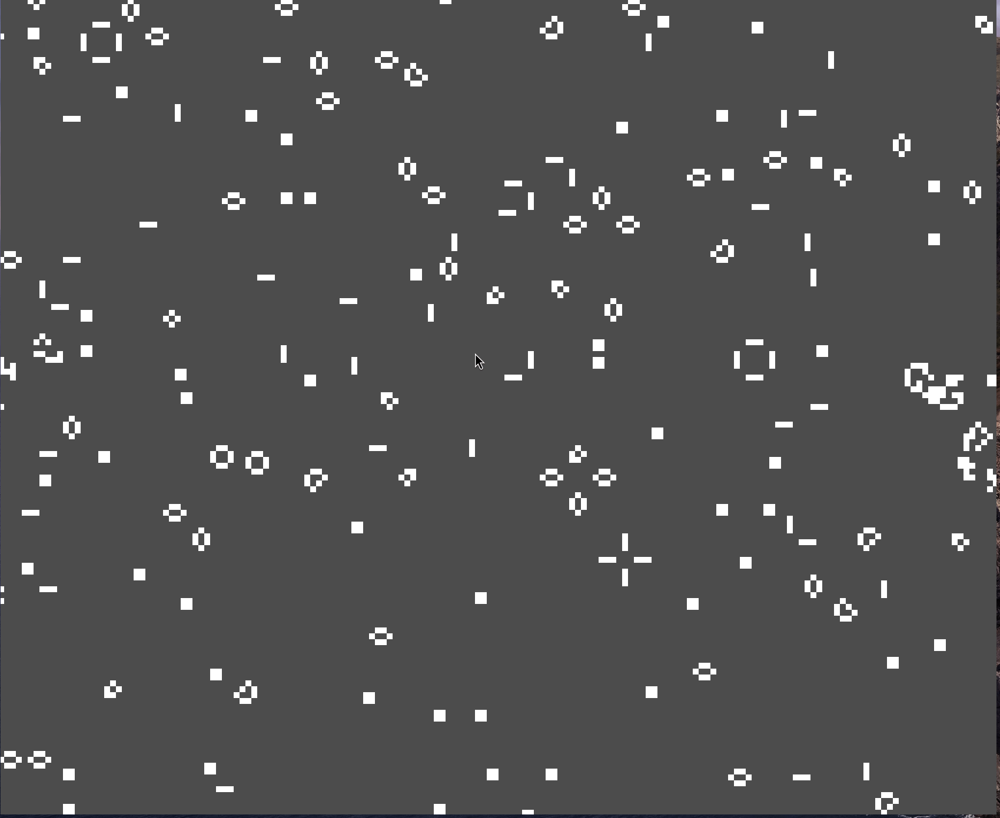

# sea-of-life

Conway's game of life, in C and OpenGL.
Includes keyboard controls to explore (arrow keys, space bar to reset life, and “r” to reset the camera.

[NY Times article](https://www.nytimes.com/2020/12/28/science/math-conway-game-of-life.html#:~:text=Given%20that%20Conway's%20proof%20that,and%20most%20unpredictable%20behavior%20possible.)

## Usage

### Prerequisites

- primary development OS is Arch Linux
  - command to install neccessary dependencies on the above platform is:
    - `sudo pacman -S base-devel glfw-wayland glfw-x11 mesa mesa-utils`
    - This will install GLFW, glad source code is included with the repo

### Compilation

- run `make`
- run `./main`

## Development

### Prerequisites

- Requires GLAD and GLFW
  - primary development OS is Arch Linux
    - command to install neccessary dependencies on the above platform is:
      - `sudo pacman -S base-devel glfw-wayland glfw-x11 mesa mesa-utils`
      - This will install GLFW, glad source code is included with the repo

### Repository structure

- ├── assets/
- │ └── shaders/
- ├── demo/
- ├── include/
- ├── src/

## Example

